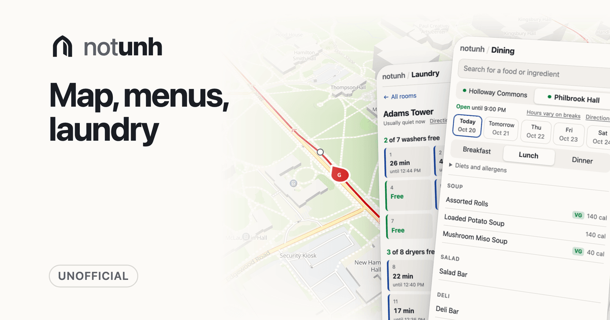

# notunh

[](https://notunh.app)

An unofficial app for UNH, at [notunh.app](https://notunh.app): live buses and walking directions, dining menus, and free laundry machines. An offline-first PWA built with Vite and [bruh](https://github.com/Technical-Source/bruh).

```sh
npm install
npm run dev           # http://localhost:5173
npm test
npm run typecheck
npm run worker        # the API on http://localhost:8787 with a local D1
```

`NOTUNH_OFFLINE=1 npm run dev` runs on the test fixtures without fetching anything.

## Docs

- [Development](docs/development.md): layout, conventions, scripts, and environment
- [Deploying](docs/deploying.md): builds, workflows, secrets, rollbacks, and search
- [Offline](docs/offline.md): the service worker and live updates
- [Storage](docs/storage.md): every artifact and table, and how long it's kept
- [Transit](docs/transit.md): locating buses, forecasting, and trip planning
- [Map](docs/map.md): map data, tiles, walking, and place search
- [Worker](docs/worker.md): the API, crons, and laundry
